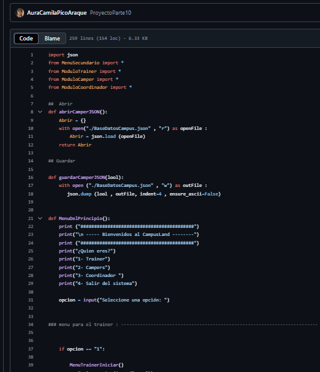

  

## Sobre mí
 

  Soy <b>Aura Camila</b>, desarrolladora de software. Me muevo entre el <b>desarrollo web</b> y las <b>bases de datos</b>, y me gusta construir cosas que se puedan abrir, probar y mejorar. Despliega cada apartado para conocerme un poco más.

  
<b>👩‍💻 Quién soy</b>

   
  Aprendo mejor practicando, así que casi todo lo que sé lo he llevado a proyectos reales o de práctica. Si algo no sale a la primera, lo vuelvo a intentar hasta que funcione: la constancia es lo que más me define como desarrolladora.
 
  - 🎯 **Enfoque:** desarrollo web y bases de datos
  - 🧩 **Me gusta:** convertir una idea en algo que se pueda ver y usar
  - 🌱 **Mi filosofía:** crecer un poco con cada commit

  
<b>📚 Aprendiendo</b>

   

  | Tema | Para qué |
  |---|---|
  | **Python (backend)** | Construir la lógica y las APIs detrás de las aplicaciones |
  | **SQL avanzado** | Diseñar y consultar bases de datos de forma más eficiente |
  | **Git y GitHub** | Trabajar en equipo con un flujo ordenado de ramas y commits |
 

  
<b>🛠️ Cómo trabajo</b>

   

  - Empiezo entendiendo el problema antes de escribir código
  - Prefiero avanzar en pasos pequeños y probar seguido
  - Documento lo que hago para que otros (y yo en el futuro) lo entiendan
  - Pido ayuda y feedback cuando lo necesito
  

  
<b>🤝 Abierta a</b>

   

  - Colaborar en proyectos web y de bases de datos
  - Prácticas y oportunidades para seguir creciendo
  - Retos que me saquen de la zona cómoda
  📫 Escríbeme a [auracamilapico@gmail.com](mailto:auracamilapico@gmail.com) o por [LinkedIn](https://www.linkedin.com/in/aura-camila-p-3125a4339/).
 

  
<b>☕ Un poco más personal</b>

   
   Me motiva aprender tecnologías nuevas y compartir lo que voy descubriendo, todo es mejor si es en compañia.
 

 

<!-- Sección de Habilidades -->
##  Tecnologías y Habilidades

  

   

## Proyectos destacados
 
<table align="center">
  <tr>
    <td align="center" width="50%" valign="top">
      
      <h3>🏎️ Formula 1</h3>
      Sitio interactivo para explorar información de la Fórmula 1. 
      <code>HTML</code> <code>CSS</code> <code>JavaScript</code>
      

        
<b>Ver más</b>

        

          <b>Qué es:</b> una página web interactiva para consultar información de la Fórmula 1. 
          <b>Lo que trabajé:</b> estructura en HTML, estilos en CSS e interacciones con JavaScript. 
          <b>Código:</b> <a href="https://github.com/AuraCamilaPicoAraque/Formula1">repositorio en GitHub</a>
        

      

    </td>
    <td align="center" width="50%" valign="top">
      
      <h3>📈 Kario Media</h3>
      Plataforma web para una consultora digital. 
      <code>Bootstrap</code> <code>HTML</code> <code>CSS</code>
      

        
<b>Ver más</b>

        

          <b>Qué es:</b> el sitio web de una consultora digital, pensado para presentar sus servicios. 
          <b>Lo que trabajé:</b> diseño responsivo con Bootstrap, HTML y CSS. 
          <b>Código:</b> <a href="https://github.com/AuraCamilaPicoAraque/Kario-Media">repositorio en GitHub</a>
        

      

    </td>
  </tr>
  <tr>
    <td align="center" width="50%" valign="top">
      
      <h3>🎓 BaseDatosCampusLand</h3>
      Sistema de gestión de base de datos para CampusLand. 
      <code>Python</code> <code>SQL</code>
      

        
<b>Ver más</b>

        

          <b>Qué es:</b> un sistema para gestionar la información de CampusLand en una base de datos. 
          <b>Lo que trabajé:</b> diseño de tablas, consultas en SQL y lógica en Python. 
          <b>Código:</b> <a href="https://github.com/AuraCamilaPicoAraque/BaseDatosCampusLand">repositorio en GitHub</a>
        

      

    </td>
    <td align="center" width="50%" valign="top">
      
      <h3>📂 Portafolio</h3>
      Portafolio personal con los proyectos que he desarrollado. 
      <code>HTML</code> <code>CSS</code> <code>JavaScript</code>
      

        
<b>Ver más</b>

        

          <b>Qué es:</b> mi página personal donde reúno y muestro lo que he construido. 
          <b>Lo que trabajé:</b> maquetación, estilos y detalles interactivos con JavaScript. 
          <b>Ver en vivo:</b> <a href="https://auracamilapicoaraque.github.io/Portafolio/">auracamilapicoaraque.github.io/Portafolio</a> 
          <b>Código:</b> <a href="https://github.com/AuraCamilaPicoAraque/Portafolio">repositorio en GitHub</a>
        

      

    </td>
  </tr>
</table>

Toca la imagen para ir al código o despliega "Ver más" para ver el detalle.

 

 

## Actividad

  
  &nbsp;&nbsp;
  

 
